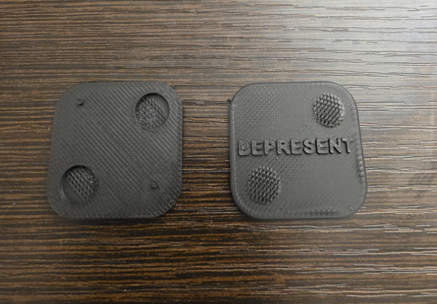
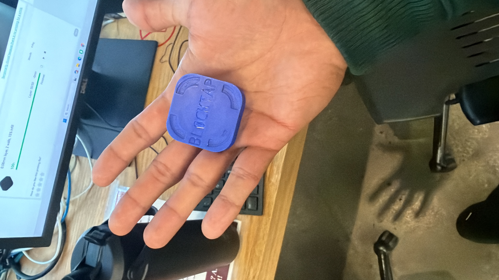

## Physical blocking device experiment
[brick-clone-ios](brick-clone-ios/) is an independent experiment exploring a physical device for blocking distracting apps. It is not affiliated with, endorsed by, or sponsored by Brick, BePresent or the company behind it.

### V1 physical brick

### V2 physical brick

